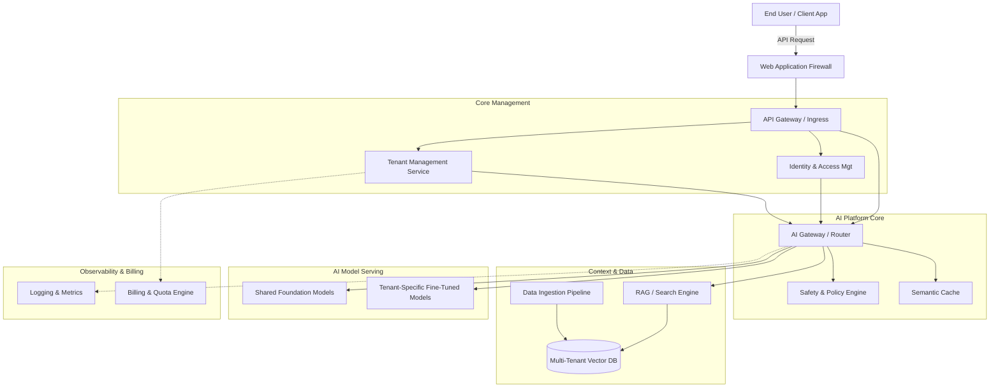

# Multi-Tenant Enterprise AI Platform Architecture

## 1. Architecture Overview

A Multi-Tenant Enterprise AI Platform is a centralized system that allows a company to securely offer artificial intelligence services (like custom chatbots, document analysis, or code generation), to multiple different business clients (tenants) at the same time. 

Instead of building a separate, expensive AI infrastructure for every single client, this architecture shares the heavy underlying hardware (like GPUs) across all clients. However, it enforces strict digital boundaries so that Client A can never see Client B's data, custom prompts, or private documents. 

We are using a **cloud-agnostic microservices** approach. This means the system is built out of small, independent puzzle pieces (containers) that can run on AWS, Azure, Google Cloud, or even in a private data center, preventing you from being locked into a single vendor.

## 2. Architecture Diagram

## 3. End-to-End System Flow

Here is how a request travels through the system when a user asks the AI a question:

1. **The Request Arrives:** A user types a prompt into their application. The request hits our Web Application Firewall (which blocks hackers) and enters the **API Gateway**.
2. **Who Are You? (Identity & Tenancy):** The API Gateway talks to the **Identity System** to verify the user's password/token. It also tags the request with a specific "Tenant ID" (e.g. Client A) so the system knows exactly who is asking.
3. **Safety & Quota Check:** The request moves to the **AI Gateway**. Before doing any heavy lifting, it checks if the prompt contains malicious instructions (Policy Engine) and verifies that Client A hasn't run out of their monthly AI budget (Billing & Quota).
4. **Brain Boost (Retrieval):** If the user is asking about private company documents, the system securely queries the **Vector Database**. It uses the "Tenant ID" to ensure it *only* retrieves Client A's private data, ignoring everyone else's. 
5. **Thinking (Model Execution):** The enriched prompt (user's question + private data) is sent to the **Model Serving Layer**. This layer efficiently routes the question to an available AI model to generate the text. 
6. **Delivery & Tracking:** The AI's answer is sent back to the user. Simultaneously, the system logs exactly how much compute power was used so Client A can be billed accurately at the end of the month.

## 4. Well-Architected Framework Analysis

### 4.1 Operational Excellence
* **What it means:** Making the system easy to update and monitor without breaking things.
* **How we do it:** Everything is deployed using automated code (Infrastructure as Code). If a new version of the AI model needs to be released, we slowly roll it out to 10% of users first to ensure it works perfectly before giving it to everyone. 

### 4.2 Security
* **What it means:** Keeping data private and safe from both hackers and other tenants.
* **How we do it:** We use strict **Row-Level Security** in our databases, meaning every single piece of data is stamped with a Tenant ID. Even if a software bug occurs, the database physically refuses to show Client A's data to Client B. All data is scrambled (encrypted) when it is stored and when it is traveling over the internet.

### 4.3 Reliability
* **What it means:** The platform stays online even if a server catches fire.
* **How we do it:** The microservices are spread across multiple physical data centers. If the primary AI model gets overwhelmed or crashes, the AI Gateway instantly routes traffic to a backup model so the end user never notices a hiccup.

### 4.4 Performance Efficiency
* **What it means:** Answering user questions quickly without lag.
* **How we do it:** We use a **Semantic Cache**. If User 1 asks, "What is our refund policy?" and User 2 asks, "How do refunds work?", the system realizes it's the same question and instantly delivers the saved answer to User 2 without waking up the heavy AI model. 

### 4.5 Cost Optimization
* **What it means:** Not wasting money on expensive hardware.
* **How we do it:** Instead of buying separate, dedicated AI servers for every single client, we use a shared pool of servers. The system dynamically groups requests together (batching) to squeeze the maximum amount of work out of every GPU, drastically lowering the cost per user.

### 4.6 Sustainability
* **What it means:** Being environmentally friendly by reducing electricity and compute waste.
* **How we do it:** We implement auto-scaling. During the night or on weekends when nobody is using the platform, the system automatically shuts down 90% of the heavy AI servers, significantly reducing energy consumption and our carbon footprint.

## 5. Technical Glossary

* **Multi-Tenant:** A single software system that serves multiple different customers (tenants). Think of it like an apartment building: everyone shares the same plumbing and electricity, but each person has their own secure, locked apartment.
* **Microservices:** Breaking down a massive application into small, independent pieces (like Lego blocks) that talk to each other. 
* **API Gateway:** The digital "front desk" receptionist of the system. It takes incoming requests and routes them to the correct internal department.
* **RAG (Retrieval-Augmented Generation):** Giving the AI an "open book test." Before the AI answers a question, the system looks up facts in the company's private documents and hands those facts to the AI so it doesn't guess or hallucinate.
* **Vector Database:** A special type of database built for AI. Instead of organizing data in neat rows and columns, it stores data based on its *meaning*, making it incredibly fast to find documents related to a user's question.
* **GPU (Graphics Processing Unit):** The heavy-duty computer chips required to run modern AI models quickly. They are expensive, so sharing them efficiently is critical.
* **Semantic Cache:** A smart memory bank that remembers past AI answers. Unlike normal caches that look for exact word matches, a semantic cache understands *intent* and can match questions that are phrased differently.
