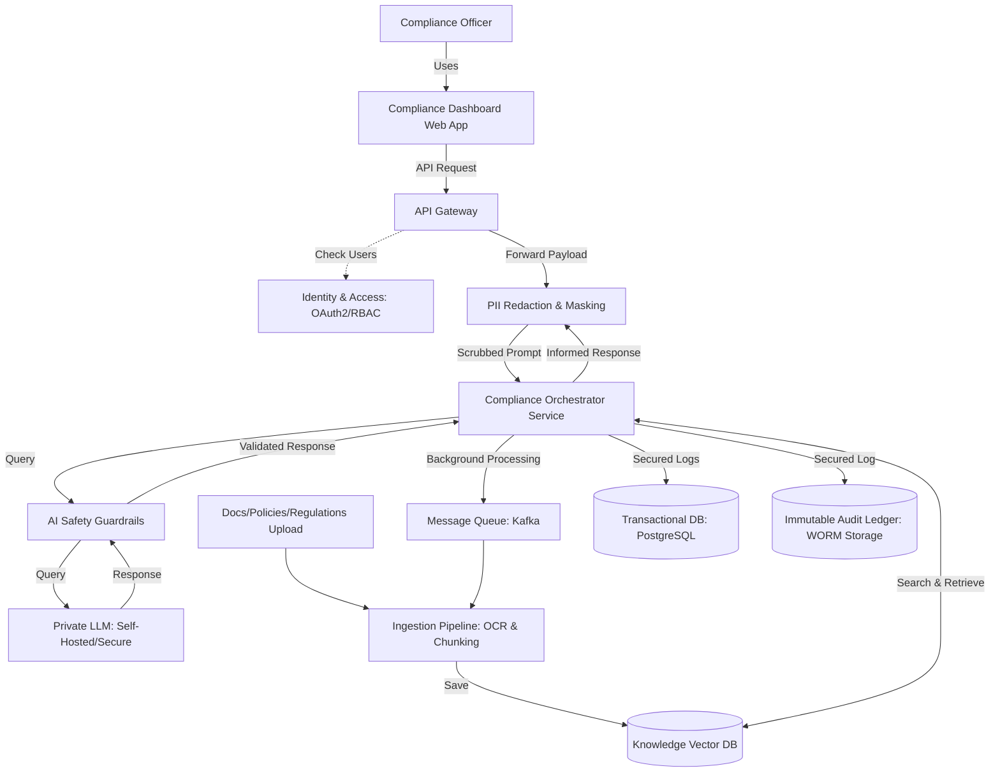

# AI-Powered Banking Compliance Assistant Architecture

## 1. Architecture Overview
This architecture provides an AI-powered compliance assistant designed specifically for the strict security and privacy requirements of a bank. It allows compliance officers to interact with a secure web dashboard to analyze data and documents. To prevent any sensitive customer data from leaking, all requests pass through a dedicated PII Redaction and Masking layer before the AI sees them. The system uses a self-hosted Private LLM to ensure all data processing remains strictly within the bank's secure network. Every AI interaction is monitored by AI Safety Guardrails, and all actions are permanently recorded in an Immutable Audit Ledger to guarantee regulatory compliance and traceability.

## 2. Architecture Diagram

## 3. End-to-End System Flow
*   **User Access:** A Compliance Officer logs into the Compliance Dashboard Web App to ask a question or review a case.
*   **Security Check:** The app sends an API request to the API Gateway. The gateway verifies the user's permissions via the Identity & Access service using OAuth2/RBAC.
*   **Data Masking:** The request flows to the PII Redaction & Masking service, which scrubs out sensitive personal and account data.
*   **Orchestration:** The safely scrubbed prompt is handed off to the Compliance Orchestrator Service, which manages the rest of the workflow.
*   **Knowledge Retrieval:** The Orchestrator searches the Knowledge Vector DB to find the exact bank policies or regulations needed to answer the user's prompt.
*   **AI Processing:** The Orchestrator sends the query and the retrieved documents through the AI Safety Guardrails and into the Private LLM. The LLM is self-hosted and secure, ensuring no data leaves the bank.
*   **Background Tasks:** If the user uploads large documents, the Orchestrator offloads that heavy work to a Message Queue running on Kafka. The Ingestion Pipeline then uses OCR and chunking to process and save these files into the Vector DB.
*   **Auditing:** Before returning the answer, the Orchestrator saves secured logs to a PostgreSQL Transactional DB and an Immutable Audit Ledger using WORM Storage.
*   **Final Delivery:** The safe, informed response is sent back through the gateway to the officer's dashboard.

## 4. Well-Architected Framework Analysis

### 4.1 Operational Excellence
By breaking the system into microservices like the API Gateway and the Compliance Orchestrator, engineering teams can update specific parts of the app without taking the whole system offline. Moving heavy tasks to a Kafka Message Queue ensures the system stays responsive even when processing massive regulatory documents.

### 4.2 Security
Security is built into every layer. Identity & Access uses OAuth2/RBAC to guarantee that only authorized compliance officers can use the system. PII Redaction ensures no sensitive customer data is accidentally fed to the AI. Furthermore, using a Private LLM that is self-hosted means zero data is transmitted to external AI providers. 

### 4.3 Reliability
The architecture relies on an asynchronous Message Queue (Kafka) to handle background processing. This design prevents the system from crashing or timing out if multiple users upload large documents simultaneously, as tasks wait in line to be processed safely.

### 4.4 Performance Efficiency
The Ingestion Pipeline pre-processes massive policy documents using OCR and chunking, turning text into numbers stored in a Knowledge Vector DB. This allows the Orchestrator to search millions of pages in milliseconds rather than having the AI read entire documents from scratch for every single question.

### 4.5 Cost Optimization
Using a Self-Hosted Private LLM allows the bank to avoid the expensive, recurring per-token fees associated with public cloud AI APIs. The system also utilizes open-source data storage solutions like PostgreSQL for the Transactional DB, which eliminates expensive enterprise database licensing costs.

### 4.6 Sustainability
The system optimizes computing power by only sending highly relevant document snippets from the Knowledge Vector DB to the LLM. This targeted search method requires far less raw processing power and electricity compared to feeding massive, un-chunked documents into a language model on every query.

## 5. Technical Glossary
*   **PII Redaction & Masking:** A security tool that automatically finds and removes sensitive personal details (like names or account numbers) from text so the AI never sees them.
*   **OAuth2/RBAC (Role-Based Access Control):** Security frameworks that verify a user's identity and restrict what data they are allowed to see based on their specific job title.
*   **Private LLM:** A Large Language Model (the AI engine) that runs entirely on the bank's own secure servers, rather than on public cloud servers like OpenAI or Google.
*   **OCR (Optical Character Recognition):** Technology used in the Ingestion Pipeline to digitally "read" text out of scanned images or PDF documents.
*   **Message Queue (Kafka):** A traffic-management tool that lines up heavy background processing tasks so they don't slow down the main user dashboard.
*   **Knowledge Vector DB:** A specialized database that stores document chunks as mathematical numbers, making it incredibly fast for the AI to find relevant policy information.
*   **WORM Storage (Immutable Audit Ledger):** Stands for "Write Once, Read Many." It is a secure storage method where logs can be saved but absolutely never edited or deleted, which is required for strict legal audits.
